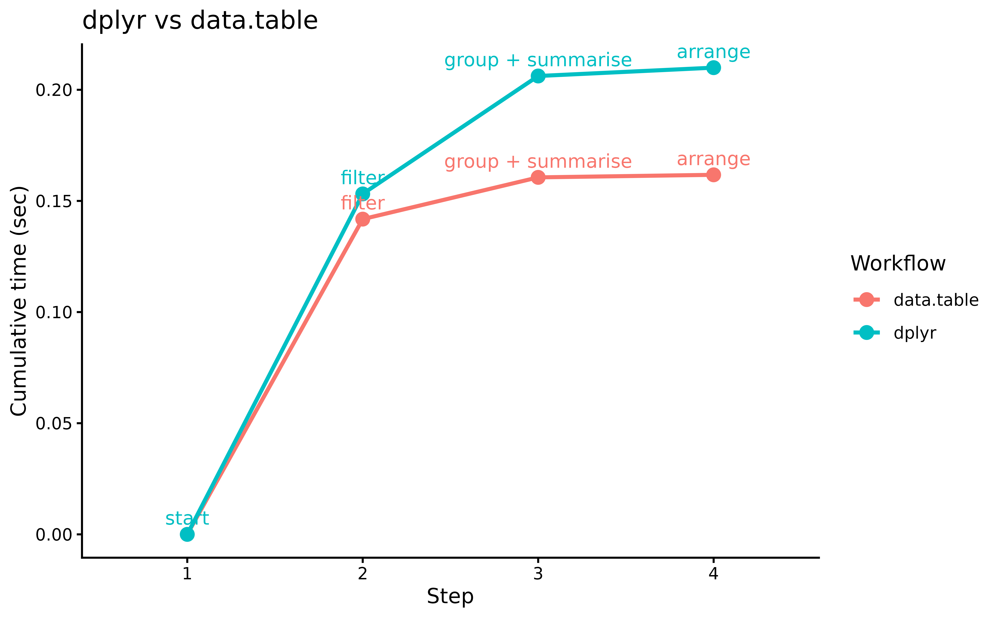

# Timing R Pipelines

## Overview

`pipetime` enables **inline** timing of R pipelines (`|>`), helping
identify performance bottlenecks and compare different approaches
without disrupting your workflow.

We illustrate this with a classic comparison: `dplyr` vs `data.table`
for a grouped aggregation pipeline. Both are excellent packages, but
`data.table` is known for its speed advantage on larger datasets.

- **Workflow A** 🐢 : Uses `dplyr` verbs.

- **Workflow B** 🚀: Uses `data.table` syntax wrapped in a pipe-friendly
  style.

### Example Data

``` r
set.seed(42)
n <- 1e6

sales <- data.frame(
  region = sample(state.abb, n, TRUE),
  product = sample(paste0("SKU_", 1:500), n, TRUE),
  revenue = round(runif(n, 1, 1000), 2),
  qty = sample(1:50, n, TRUE)
)
sales_dt <- as.data.table(sales)
head(sales, n = 3)
#>   region product revenue qty
#> 1     WI SKU_269  225.85   6
#> 2     OR SKU_433  103.87  49
#> 3     AL SKU_384  832.50  38
```

### Timing Workflows

We use the `log` argument so each workflow stores its timings
separately.

``` r
library(pipetime)
options(pipetime.console = FALSE)

# Workflow A: dplyr
wf_A <- sales |>
  filter(revenue > 100) |>
  time_pipe("filter", log = "dplyr") |>
  group_by(region) |>
  summarise(total = sum(revenue), avg_qty = mean(qty), .groups = "drop") |>
  time_pipe("group + summarise", log = "dplyr") |>
  arrange(desc(total)) |>
  time_pipe("arrange", log = "dplyr")

# Workflow B: data.table
wf_B <- sales_dt |>
  (\(dt) dt[revenue > 100])() |>
  time_pipe("filter", log = "data.table") |>
  (\(dt) dt[, .(total = sum(revenue), avg_qty = mean(qty)), by = region])() |>
  time_pipe("group + summarise", log = "data.table") |>
  (\(dt) dt[order(-total)])() |>
  time_pipe("arrange", log = "data.table")
```

## Results

``` r
# Collect both logs
logs <- get_log() |>
  bind_rows(.id = "workflow") |>
  group_by(workflow) |>
  # Add a starting point
  group_modify(~ add_row(.x, duration = 0, label = "start", .before = 1)) |>
  mutate(step = factor(row_number()))

library(ggplot2)
logs |>
  ggplot(
    aes(
      x = step,
      y = duration,
      colour = workflow,
      group = workflow
    )
  ) +
  geom_line(linewidth = 1) +
  geom_point(size = 3) +
  geom_text(aes(label = label), vjust = -0.7, size = 3.5, show.legend = FALSE) +
  labs(
    x = "Step",
    y = "Cumulative time (sec)",
    title = "dplyr vs data.table",
    colour = "Workflow"
  ) +
  theme_classic()
```



`data.table`’s in-memory optimizations give it a consistent edge,
especially on the grouped aggregation step. `pipetime` makes it easy to
pinpoint exactly where the difference lies.
